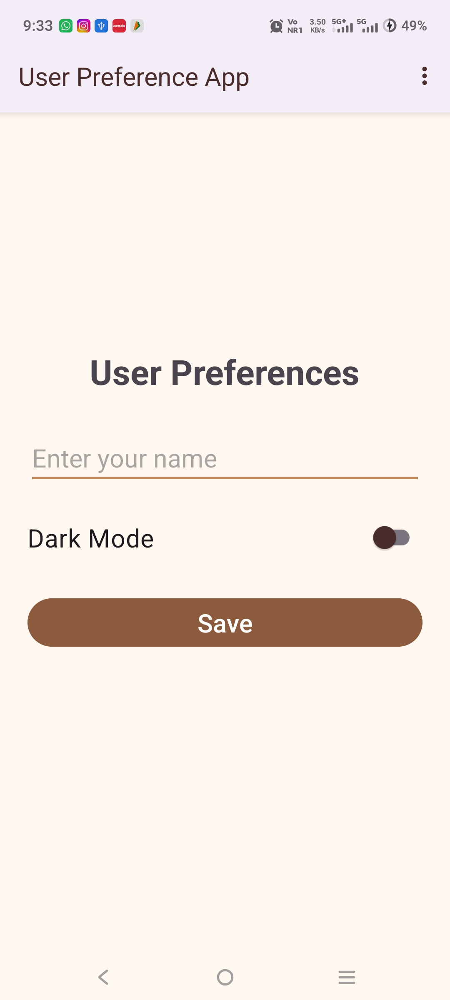
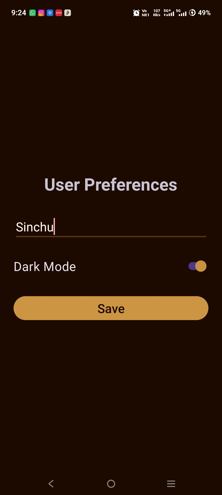
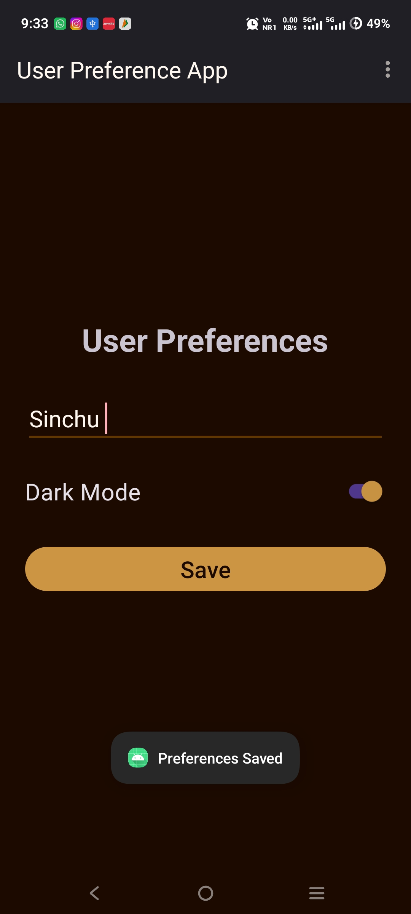
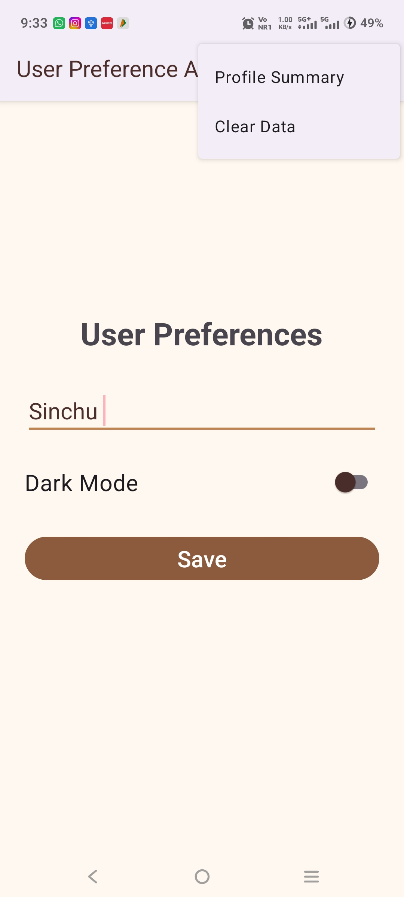
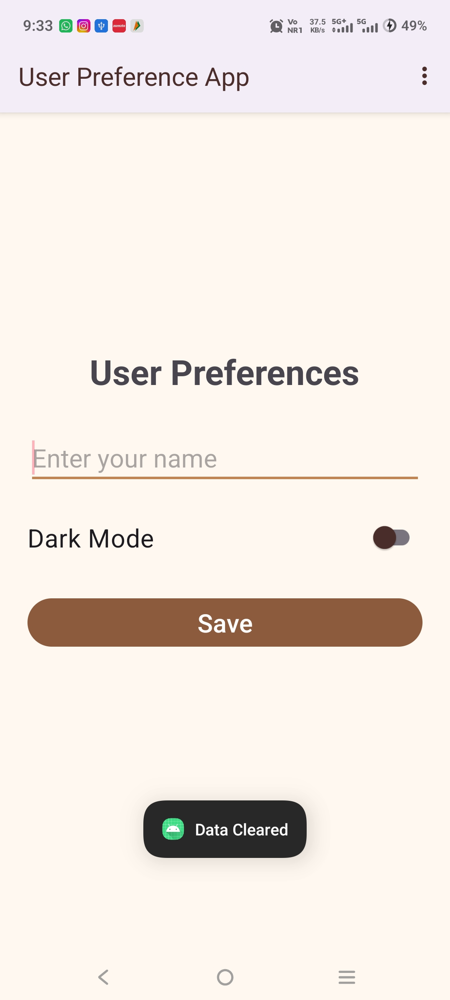

Given question:
Develop a two-activity Android application (User Preferences App) that demonstrates data
persistence, menu navigation, and inter-activity communication:

1. MainActivity
(Input & Persistence): Design a layout containing an EditText
for the user's name, a Switch for "Dark Mode /
Notifications", and a "Save" Button. Use
SharedPreferences to save both the
username (String) and the switch state (Boolean) so that they remain intact when the application
restarts.

2. Options
Menu: Add an Options Menu to MainActivity
with two menu items: "Profile
Summary" and "Clear
Data".

3. Intent
Navigation (ProfileActivity): Clicking "Profile Summary"
in the menu must use an Explicit
Intent to open ProfileActivity, which displays the
saved username and whether the switch is currently ON or OFF. Clicking "Clear Data"
must wipe the stored preferences and reset the UI fields to their defaults.

